# MoLink v2 评测报告：两台机器、受限网络，跑同一个大模型，比原生 vLLM 快多少

本文是 MoLink v2（代码内部名 hetvllm）的完整评测材料，可以独立阅读：结论、方法、技术细节。
配套：[`../figs/`](../figs/)（图）、[`../data/`](../data/)（原始数据和汇总表）、
[`../patch/`](../patch/)（对 vLLM 的补丁）、[`../kit/`](../kit/) 和
[`REPRODUCE.md`](REPRODUCE.md)（复现脚本和步骤）。本文所有数字都来自 2026-10-30 / 10-31 的
同一版代码（补丁见 `patch/`）。

---

## 0. 一页结论

**场景**：一个大模型同时放在两台机器上推理。A 机两张 RTX 4090，B 机两张 RTX 3090，
两机之间的网络带宽受限（用 `tc` 限到 100/250/500/1000 Mbps）。模型前 28 层在 A，
后 20 层在 B；每台机器内部两张卡再各分一半（张量并行）。每生成一步，A 都要把中间
结果通过网络发给 B。网络慢时，这一步就是瓶颈。

**结果**（Qwen3-30B-A3B，`--best`；和原生 vLLM 用同样的切分、同样的机器，在同一时段先后
运行。原生跑两次：vLLM 对 MoE 模型默认的 V1 执行器，以及强制打开的 V2 执行器，见 §2.1）：

| 指标 | 我们 | 原生（默认 V1） | 倍率 | 对原生 V2 的倍率 |
|---|---|---|---|---|
| 40 项配对测试的几何均值（含义见 §2.3、§2.4） | | | **1.91×** | **1.54×** |
| 长输入处理（prefill），100 Mbps，48 个 8K 输入全部做完 | 52.1 s | 327.8 s | **6.29×** | 5.63× |
| 混合负载，100 Mbps，72 个请求全部做完 | 47.6 s | 211.7 s | **4.45×** | 4.10× |
| 过载服务质量：250 Mbps 下 300 秒持续来请求，满足全部时延要求的请求 | **153 / 155** | **0 / 155** | 原生为 0 | 原生 V2：6 / 155 |
| 同一实验：首个 token 的等待时间（中位数） | 1.0 s | 49.2 s | **50×** | 原生 V2：9.0 s |
| 空泡率（GPU 没在做模型计算的时间占比，A 机 / B 机，250 Mbps） | 58% / 56% | 94% / 90% | 相对降低 38%（未达 50%） | §7.2 |
| 空泡率，PP2（1 张 4090 + 1 张 3090，Qwen3-8B，切分 24/12），A / B，250 Mbps | 41% / 39% | 89% / 81%（该模型原生默认是 V2） | **相对降低 54% / 52%** | §7.4 |
| 精度 | 见 §8 | | | |

一句话：**网络越慢，优势越大；到 1 Gbps 仍快 1.42×。**

**为什么报两个原生基线**：V2 执行器是上游 vLLM 的代码，只是 MoE 模型默认不用它。“对原生
默认”是用户直接拿 vLLM 能得到的；“对原生 V2”扣掉了执行器这一项，只剩我们自己的改动。
不受前缀缓存影响的口径（关闭前缀缓存的 12 项，§5）：对原生默认 **2.28×**、对原生 V2
**1.83×**。

**其他模型和拓扑**（§6）：Qwen3-32B（稠密）40 项 **1.25×**、100 Mbps 1.67×；PP4（4090,
4090 | 3090, 3090）对原生 PP4 **2.53×**（V1）/ **1.90×**（V2）；Qwen3-8B（1 张 4090 + 1 张
3090）对原生 **1.97×**。

**加速从哪来**（§5 消融）：最大的一块是“少传字节”（int4 编码 + 残差合并，跨机字节降到原生的
0.14×）。执行器换成 V2（decode 不再在两段之间串行）对原生本身也有 1.24×，所以单独报“对原生
V2”的倍率。调度器的控制面瘦身（`--tok-tail`）在我们的系统上再快 14%。TP-C 调度默认不开：它用
吞吐换逐 token 时延，只在 B 端算力弱、又要求严格时延时值得开（`--best-tpc`，§3.6）。

---

## 1. 背景：为什么网络会拖慢推理

### 1.1 两台机器怎么分工

```
  A 机（2×4090）                      网络（受限）                    B 机（2×3090）
  调度器 + 第 0–27 层  ──每步：中间结果（每个 token 一行）──▶  第 28–47 层 + 输出层 + 采样
                       ◀──────────── 每步：采样出的 token ────────
```

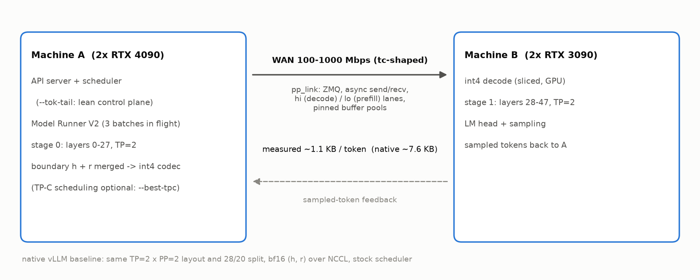

- **流水线并行（PP=2）**：模型按层切成两段，A 做前一半，B 做后一半。
- **张量并行（TP=2）**：每台机器内部，两张卡各算每一层的一半，每层结束用机内
  all-reduce 合并结果。
- 这就是“TP2×PP2”布局。我们和原生 vLLM 都用这个布局，层的切分也相同（A 28 层、
  B 20 层，`VLLM_PP_LAYER_PARTITION=28,20`）。

### 1.2 几个词

| 词 | 意思 |
|---|---|
| token | 模型处理文字的最小单位，大致相当于一个词或半个词 |
| prefill（预填充） | 处理用户输入的整段提示词。输入有多少 token，这一步就要算多少行 |
| decode（解码） | 逐个生成输出 token。每个正在生成的请求，每一步只算 1 行 |
| 步 / 批 | 推理引擎每一轮把若干请求打包成一批一起算，叫一步。一批的“行数”= 这一步要算的 token 数 |
| 执行器（model runner） | vLLM 里在每张卡上真正跑一步计算的组件。有 V1 和 V2 两个版本（§3.1） |
| TTFT | 从发出请求到收到第一个输出 token 的时间 |
| TPOT | 输出阶段平均每个 token 的间隔 |
| ITL | 相邻两个输出 token 的实际间隔（看最慢的那些用 p95） |
| SLO | 服务质量要求，这里是每个请求的 TTFT、TPOT、ITL 上限 |
| goodput | 每秒完成的、满足全部 SLO 的请求数 |

### 1.3 每个 token 要传多少字节

B 接着算第 28 层，需要第 27 层输出的两个向量（§3.4 详细解释）：

- `hidden_states`：形状 `[本步 token 数, 2048]`，bf16（每个数 2 字节）
- `residual`：形状 `[本步 token 数, 2048]`，bf16

所以原生 vLLM 每个 token 要发 2 × 2048 × 2 = **8192 字节**。250 Mbps ≈ 31 MB/s，
一个 4096 token 的 prefill 步光传输就要 4096 × 8192 B ÷ 31 MB/s ≈ **1.07 秒**。这期间
B 只能等。而且排在这一步后面的 decode 步（每个正在输出的用户都在等它）也只能等。

---

## 2. 怎么比较

### 2.1 基线：原生 vLLM

- 原生 vLLM 跑的是**同一份打过补丁的代码**，但所有 `HETVLLM_*` 开关都不开。补丁在
  开关关闭时不改变任何上游行为（可以对照 `patch/` 逐行检查）。所以原生的跨机传输
  就是 vLLM 自带的 NCCL 方式，调度器就是 vLLM 自带的调度器。
- **两个原生基线**：
  - **原生默认**：vLLM 对 MoE 模型（Qwen3-30B-A3B）默认用 V1 执行器。用户直接拿 vLLM
    得到的就是它。
  - **原生 V2**：设 `VLLM_USE_V2_MODEL_RUNNER=1` 强制用上游的 V2 执行器，不改任何代码。
    我们的 `--best` 也用 V2，所以“对原生 V2”的倍率只含我们自己的改动。
  - 稠密模型（Qwen3-32B、Qwen3-8B）vLLM 默认就是 V2，这时只有一个原生基线。
- **原生也用了我们调好的 fused-MoE 配置**（§3.7）。vLLM 按 GPU 型号自动加载这些配置
  文件，与开关无关（启动日志可见 `Using configuration from .../E=128,N=384,
  device_name=NVIDIA_GeForce_RTX_4090.json`）。所以这项调优让双方都变快，**对倍率的
  贡献是 0**，原生基线因此比真正的“纯上游”更强。
- 两边共同的引擎参数：ray 执行器；每步最多 4096 个 token（`max-num-batched-tokens`）；
  最多 64 个并发请求；最长 16384 token；显存占用 0.90；开 CUDA graph；开异步调度；开前缀
  缓存（§2.5）。同时在飞的批数由执行器决定：V1 是 2，V2 是 3。

### 2.2 测试负载（每一项的具体配置）

所有请求：温度 0（贪心解码）；流式返回；`ignore_eos`，即一定生成到规定长度；提示词
是随机的 token ID（取值 1000–100000），用请求序号做随机种子。

| 名字 | 做什么 | 具体配置 | 记什么 |
|---|---|---|---|
| decode M=1/4/16/32 | 测 M 个用户同时生成长回答 | M 个请求同时发出；每个输入 2048 token，输出 1024 token | 总输出 token ÷ 总时长（含开头的 prefill） |
| decode M=16, 256-in | 同上，短输入 | 16 个请求，输入 256，输出 1024 | 同上 |
| decode M=16, 4K-in | 同上，长输入 | 16 个请求，输入 4096，输出 1024 | 同上 |
| prefill 48×2K / 4K / 8K | 测处理长输入 | 48 个请求同时发出；输入 2048 / 4096 / 8192；输出 64 | 48 个全部完成的总时长 |
| fixed mix（混合） | 长短请求混在一起 | 72 个请求同时发出：24 个（输入 8192，输出 128）+ 48 个（输入随机取 256 或 512，输出 512） | 全部完成的总时长 |
| SLO 过载实验 | 测持续来请求时的服务质量 | 300 秒内按泊松过程以平均 0.5 个/秒到达（固定种子，共 155 个）；每个输入随机取 4096 或 8192，输出 128 | 每个请求同时满足 TTFT ≤ 12 s、TPOT ≤ 100 ms、ITL p95 ≤ 200 ms 才算达标；goodput = 达标数 ÷ 实验总时长 |

decode 记吞吐（越高越好）；prefill 和混合记总时长（越短越好）。倍率一律写成
“我们比原生快多少倍”：decode 是 我们的吞吐 ÷ 原生的吞吐，prefill/混合是 原生的时长
÷ 我们的时长。大于 1 表示我们更快。

### 2.3 什么是“40 项配对测试”

- 上表前 10 行是 10 种负载（decode 6 种 + prefill 3 种 + 混合 1 种），每种在 4 档带宽
  （100/250/500/1000 Mbps）各跑一次，共 10 × 4 = **40 项**。
- **配对**：同一项（同一负载、同一带宽）我们和原生各跑一次，同样的机器，同一时段
  先后执行。
- 每个系统一次启动后连续跑完 4 档 40 项，每换一档带宽都核对 `tc` 设置已生效。

### 2.4 什么是“几何均值”

40 个倍率要合成一个数，用的是几何均值：**把 n 个倍率相乘，再开 n 次方**，等价于
“先取对数、求平均、再取指数”。

为什么不用普通平均：倍率是比值。假设一项快 2 倍、另一项慢 2 倍（0.5×），两者实际
互相抵消，几何均值是 √(2 × 0.5) = **1.0×**，而算术平均会得到 (2 + 0.5) ÷ 2 =
1.25×，凭空多出 25%。几何均值让“快 2 倍”和“慢 2 倍”分量一样，并且每一项权重相同，
不会因为某项绝对时间长就占主导。

### 2.5 两个口径说明

- **前缀缓存**：提示词用请求序号做种子，所以不同测试项里同序号的请求提示词相同，而
  长的提示词以短的为开头（同一随机序列）。40 项测试开着前缀缓存，后面的测试项可能
  直接复用前面算过的部分。为了确认结论不依赖缓存，§5 的 12 项在**关闭前缀缓存**下又
  测了一遍（每个 token 都真算）。在两边都测过的 12 项上比较（开缓存 ÷ 关缓存，>1 表示
  开缓存更快）：

  | 系统 | 开缓存相对关缓存（12 项几何均值，括号内为单项范围） |
  |---|---|
  | 我们 | 0.99×（0.88–1.07） |
  | 原生默认（V1） | 1.08×（0.98–1.36） |
  | 原生 V2 | 1.02×（0.77–1.32） |

  在这 12 项上，缓存对我们几乎没有作用，对原生有一点好处，所以开缓存略微**缩小**了我们的
  倍率（对原生默认：开缓存 2.09×、关缓存 2.28×；对原生 V2：1.77× 对 1.83×）。另外两项 48×2K / 4K prefill 不在这 12 项里，那里
  V2 执行器的复用很多：100 Mbps 下按每 token 跨机字节算，48×2K 光传完全部输入就要 9.1 s
  （我们）/ 60 s（原生），实测我们 5.9 s、原生 V2 29.7 s，都快过这个下限，说明有大量 token
  直接命中缓存；原生默认（V1）是 56.5 s，几乎不命中。这两项“对原生默认”的倍率里有一部分
  来自 V2 执行器的缓存复用，“对原生 V2”没有这个差别。
- **跨机字节**用 A 机网卡出口的 `tc` 计数器统计，两边是同一个仪表。它统计该网卡的
  全部出口流量（包括 ray 心跳等少量其他流量），再除以本档所有请求的输入 + 输出
  token 总数。

---

## 3. 技术说明

终版 `--best` = `--link --codec int4 --merge --net-bw 0 --runner v2 --tok-tail`，包含
§3.1–§3.5；§3.6 的 TP-C 是可选项（`--best-tpc`）；§3.7 的 MoE 调参双方共享。

### 3.1 执行器换成 V2（上游代码，打开它）

**问题**：vLLM 对 MoE 模型默认用 V1 执行器。V1 在“异步调度 + 流水线并行”下，同一个
decode 请求**每一步**都会被调度；A 要先在主 CUDA 流上用 NCCL broadcast 收到 B 采样出的
上一个 token，才能算这个请求的下一步。所以 A 的下一步一定排在 B 完成之后，流水线对
decode 根本没并起来（§7：原生 A 有 88–91% 的时间在 Broadcast 里等 B）。

**做法**：上游已经有 V2 执行器（vLLM 对稠密 Qwen3 / Llama 默认就用它）。V2 在单独的
CUDA 流上收发采样 token，同一请求每隔 2 步（pp_size）才 decode 一次，同时在飞的批数是 3。
MoE 模型只要设 `VLLM_USE_V2_MODEL_RUNNER=1`（`pp2.py --runner v2`）就能用，A3B 跑通，
输出逐词不变。这不是我们的代码，所以原生也单独测了 V2（§2.1）：原生换 V2 本身就快 1.24×
（关缓存 12 项；100 Mbps 1.05×、1000 Mbps 1.46×，§5）。

### 3.2 调度器的控制面瘦身（`--tok-tail`）

**问题**：vLLM 调度器每一步生成一份 `SchedulerOutput` 发给每个 worker（B 的两个 worker
经过跨机网络收到）。凡是“上一步没被调度”的运行中请求，它都会把这个请求的**全部**
prompt + 已生成 token 列表重新放进去。V2 让每个 decode 请求隔一步才调度一次，于是
**每一步都触发**：按 16 个约 2.3K token 的请求估算，每步约 370 KB，100 Mbps 下约 30 ms。

**做法**：V2 执行器根本不读这份列表（被抢占后恢复的请求会作为新请求整份重发），V1 只读
最后 num_output_tokens 个。`HETVLLM_TOK_TAIL=1`（`pp2.py --tok-tail`）只发执行器真正读的
部分（V2：不发；V1：只发尾部）。实测（§5）：在我们的系统上快 **14%**（100 Mbps 下 2.52× →
3.37×，带宽越低越明显）；单独加在原生 V2 上快 6%（100 Mbps 下 13%）。它是 vLLM 在跨机流水线
下的通用开销，只是原生还有更大的瓶颈（每 token 8 KB 的跨机数据），所以收益小。

### 3.3 pp_link：自己写的跨机传输，替代 NCCL

**原生 vLLM 每一步怎么传**（`vllm/distributed/parallel_state.py: isend_tensor_dict`）：

1. 先把这一步的“元数据”（有哪些张量、各自的形状和类型）用 pickle 序列化，通过
   gloo（走 CPU 的 TCP 连接）发两条阻塞消息：先发长度，再发内容。B 必须先收到它，
   才知道该准备多大的接收缓冲区。这是每一步都有的一次额外跨网 CPU 消息。
2. 再用 NCCL 把 `hidden_states` 和 `residual` 两个 bf16 张量整块发过去。NCCL 在这里
   走普通 TCP（没有 RDMA）。一整步的数据作为一个整体传输：如果前面一步是 4096 token
   的 prefill（250 Mbps 下约 1 秒），后面的 decode 步只能排队等它传完。

**我们的做法**（`vllm/distributed/pp_link.py`，基于 ZMQ）：

- **一步一条消息，元数据放在消息头里**：消息的第一帧是一段 JSON 头（编号、优先级、
  各张量名字/形状/编码方式），后面是数据。不再有单独的 gloo 元数据消息。
- **切片 + 两档优先级**：每个方向开两条 TCP 连接，“hi”（高优先级，给 decode 步）和
  “lo”（低优先级，给 prefill 步）。数据切成 32 KiB 一片，发送线程每次只发一片，并且
  只要有 hi 消息在等，就先发 hi。所以 decode 消息最多等当前这一片发完（32 KiB 在
  250 Mbps 下约 1 ms），而不用等整个 prefill 消息。哪一步算 hi：开了 TP-C 时由调度器
  标记；没开时按形状判断（本步 token 数 ≤ 2 × 请求数 + 8）。
- **ack 窗口反压**：B 每收齐一条消息就回一个很小的 ack。A 记录“已发出但还没收到 ack
  的字节数”，超过 8 MB 就暂停发新消息。这样 B 忙或网络拥堵时，A 不会把一大堆数据塞进
  操作系统的发送缓冲区（塞进去的字节没法再插队，会把之后紧急的 decode 消息堵在后面）；
  积压留在 A 自己的队列里，后来的 hi 消息仍然可以排到前面。
- **两张卡各发一半**：A 的两张卡各自只发自己那一半数据（两条通道并行），B 收到后在
  机内用 all-gather 拼起来。这一点和原生的优化相同，字节数不变。
- **全程异步，不让主线程等**：
  - A：编码在 GPU 上做（§3.4），结果拼成一块后一次非阻塞拷到锁页内存，记一个 CUDA
    event，由发送线程等它完成再发。A 开始下一步时只等上一条消息交给 ZMQ，不等 B 的
    ack（不付一次跨机往返）。
  - B：ZMQ 零拷贝收帧，直接写进锁页缓冲；拷到 GPU 后按 CUDA event 回收缓冲，不做整卡
    同步；反量化分片进行，写进预先分配的 bf16 输出。
  - 锁页缓冲在启动时预先分配成池，热路径上不调用驱动分配。
- **为什么“下一步开始时要等上一条消息交给 ZMQ”**：这是正确性要求。V2 下 A 后面几步的
  kernel 排在“等 B 送回采样 token”之后；kernel 队列满了以后，A 的主线程会拿着 Python
  GIL 卡在一次 CUDA launch 里。如果这时上一条消息还没交给 ZMQ，发送线程拿不到 GIL，
  B 永远收不到这一步，也就永远送不回 token——死锁（不等任何东西的版本在 48×8K prefill 上
  必现）。等它交给 ZMQ 以后，字节由 ZMQ 自己的 IO 线程负责，不再需要 GIL。
- **单独开启时的效果**见 §5。

开发中查出并修掉的三个资源问题（都在补丁里）：
- **锁页缓冲没还**：发送后只把切片视图还给池，整块缓冲没还；decode 消息只有约 1 KB，
  于是每一步都新分配一块 4 MiB 的锁页内存。
- **接收端显存泄漏**：接收端原来每一步都在函数里新定义一个小类，用默认参数引用这一步
  收到的 GPU 张量。Python 的类对象天生处在引用环里，只能等循环垃圾回收才释放；vLLM 启动
  后调用了 `gc.freeze()`，热循环里回收又很少发生，于是收到的张量一直留在显存里。
  Qwen3-32B 每步 4096 行时约 80 MB/步，prefill 开始 20 秒内 B 的 3090 显存耗尽（把显存
  占用从 0.90 降到 0.88 也没用，说明是持续增长）。改成模块级句柄、用完即放后，同一个
  32B 引擎上 B 的显存全程恒定 23.1 GB。
- **反量化的临时显存**：原来一次性展开成 int32/fp32 中间张量（32B 一条 4096 行消息约
  167 MiB，不在 vLLM 启动时的显存估算里），改为分片后峰值 41 MiB，结果逐位相同。

### 3.4 边界编解码：把每个 token 的数据压小

A、B 交界处（第 27 层输出）的张量：

| 张量 | 形状 | 原生类型 | 每 token 字节 |
|---|---|---|---|
| `hidden_states` | `[本步 token 数, 2048]` | bf16 | 4096 |
| `residual` | `[本步 token 数, 2048]` | bf16 | 4096 |
| 合计（原生） | | | **8192** |

（2048 是 Qwen3-30B-A3B 的隐藏层宽度；Qwen3-32B 是 5120，原生每 token 20480 字节；
Qwen3-8B 是 4096。）

我们只对这个跨网传输的数据做量化（模型权重、KV cache、机内计算都保持 bf16）：

- **int8（质量档）**：每个 token 每 64 个数一组，取组内绝对值最大值算一个缩放系数
  （fp16，2 字节），每个数存成 −127…127 的 8 位整数。每个向量 2048 + 32 × 2 =
  **2112 字节**。
- **int4（吞吐档，`--best`）**：每 32 个数一组，一个 fp16 缩放系数，每个数存成 −7…7 的
  4 位整数，两个数挤进一个字节。每个向量 1024 + 64 × 2 = **1152 字节**。
- B 收到后在 GPU 上乘回缩放系数，还原成 bf16，再算第 28 层。

### 3.5 边界残差合并：两个向量只发一个

**为什么能合并**：Qwen3 每一层都维护两条数据：`residual`（之前所有层输出的累加和）
和 `hidden_states`（上一个子层的输出）。B 拿到它们后的第一件事，是第 28 层开头的
“加法 + RMSNorm”融合算子：

```
residual_new = hidden_states + residual
x            = RMSNorm(residual_new)      # 后续计算只用到 x 和 residual_new
```

也就是说，B 只会用到两者的**和**，从来不单独用其中一个。分开发两个向量是浪费。

**怎么做**：A 先算 s = hidden_states + residual（fp32 相加后舍入成 bf16），只发 s。B
收到后把 residual 设成全 0，融合算子算出 s + 0 = s，后续计算在数学上和原来等价。唯一
的数值差别是：这个和在发送前就被舍入成 bf16，而原生是在融合算子内部求和（精度见 §8）。

**效果**：每 token 从两个向量变成一个，字节数减半。再叠加 int4，每 token 1152 字节，是
原生 8192 的 **0.14×**（实测 0.14×，见图 6）。

### 3.6 TP-C 调度（可选，`--best-tpc`）：决定每一步带多少 prefill

**要解决的矛盾**：每一步可以同时包含 decode 行（每个正在输出的请求 1 行）和 prefill
行（某个长输入的一段）。prefill 段越大，这一步越慢（在弱网上还要加传输时间），所有
正在输出的用户下一个 token 都被拖慢；prefill 段越小，长输入处理得越慢，新用户首个
token 等得越久。原生 vLLM 每步尽量塞满 4096 个 token，不管正在输出的用户。

**TP-C 每一步做三件事**（代码在 `vllm/v1/core/sched/scheduler.py`）：

**① 算每个正在输出的请求还剩多少“时间预算”。** 预算由每个 token 的目标间隔 `gate_ms`
决定（A3B 默认 95 ms：SLO 要求 TPOT ≤ 100 ms，留 5 ms 余量；32B 默认 400 ms，因为 32B
一个 decode 步本身就要约 100 ms）。它是可配置参数（`HETVLLM_TPC_GATE_MS`，或运行时改
`sched_ctrl.json`）。对一个从首个 token 起已输出 n 个 token 的请求：

```
松弛量 = gate_ms × n − (现在 − 首 token 时刻)              # >0：比目标节奏超前
有效预算 = 松弛量 + α × 剩余要输出的 token 数 × gate_ms      # α = 0.6
```

加上后一项，是因为 TPOT 是整段回答的平均值，暂时落后一点可以用后面的 token 追回来。
所有正在输出的请求里，**预算最少的那个**决定这一步能放多少 prefill。

**② 预测这一批要多久才能把结果拿回来。** “往返时间”= 调度器把一批交出去，到这批的
采样 token 回到调度器的时间。模型：

```
往返时间(行数) = base + slope × 行数
```

base 是与行数无关的固定开销，slope 是每多一行增加的毫秒数。两个参数用带遗忘的最小
二乘在线拟合（每来一个新点，旧点的权重乘 0.97）。预测误差的两倍记作 eps（下限 12 ms、
上限 150 ms），作为安全余量。

**③ 决定这一步怎么组。**

- **紧急**：如果最紧的那个请求，下一个 token 已经来不及了，这一步**只放 decode 行**
  （hi 微批），走 hi 通道插队。如果有 prefill 已经等了超过 400 ms，下一步一定带上一段
  prefill（防止饿死）。
- **不紧急**：decode 行和一段 prefill 一起发。prefill 行数 R = (预算 − base) ÷ slope，
  再夹在 [64, dip 硬帽] 之间。
- **dip 硬帽**：单步行数的硬上限 = `dip_ms ÷ row_ms` = 180 ms ÷ 约 0.45 ms ≈ 400 行，
  保证一次性的“卡顿”不超过约 180 ms，不管预算多宽裕。
- **短请求快车道**：输入 ≤ 256 token 的新请求，即使在“只放 decode”的步里也能被接纳，
  并排到长输入前面。

**代价与什么时候开**：它的 CPU 开销很小（每步 0.93 ms，原生调度器 1.37 ms），代价是把
一步拆成“decode 微批 + prefill 块”并限制每步行数。V2 执行器已经让同一请求隔步 decode，
再拆一次只是多出步数：

| 场景（关前缀缓存，12 项吞吐 + 过载实验） | 不开 TP-C（`--best`） | 开 TP-C（`--best-tpc`） |
|---|---|---|
| A3B（B 有两张 3090） | 吞吐基准，SLO 151/155 | 吞吐 0.75×，SLO 155/155 |
| Qwen3-8B（B 只有一张 3090） | 吞吐基准，SLO 109/155 | 吞吐 0.79×，SLO **151/155** |

为确认是不是行数上限太紧，在同一个 A3B 引擎上热切 `dip_ms`、两轮镜像顺序（250 Mbps，
`data/a3b_tpc_dip_sweep.csv`）：

| dip 上限 | 混合负载时长 | decode M=32 | SLO 达标（两轮） | 最差 ITL p95 |
|---|---|---|---|---|
| 180 ms（默认） | 57.4 s | 874 tok/s | 155 / 155 | 108 ms |
| 360 ms | 49.6 s | 846 tok/s | 153 / 155 | 158 ms |
| 720 ms | 51.9 s | 907 tok/s | 130 / 137 | 216–265 ms |
| 不开 TP-C | 37.3 s | 1,154 tok/s | 151 | — |

放宽上限只能追回一小部分吞吐，720 ms 已没有收益、尾延迟变差。所以：**吞吐优先用
`--best`；有逐 token 时延要求、且 B 端算力弱（单卡）时用 `--best-tpc`**。不开 TP-C 时
A3B 没达标的 4 个请求都是 ITL p95 超标（约 300–360 ms），首 token 和平均 TPOT 都满足。

### 3.7 fused-MoE 调参

**是什么**：Qwen3-30B-A3B 每层有 128 个“专家”（小的前馈网络），每个 token 只送给其中
8 个。vLLM 用一个 Triton 内核（fused MoE）一次算完一层的所有专家：先按专家把 token
排序，每个专家的 token 数补齐到 `BLOCK_SIZE_M` 的整数倍，再做分组矩阵乘。这个内核
有 6 个可调参数，可以对每种 batch 大小（本步 token 数 M）分别设：

| 参数 | 含义 |
|---|---|
| `BLOCK_SIZE_M` | 一个计算块处理多少行 token。也是每个专家的补齐粒度：太大则补很多空行，太小则效率低 |
| `BLOCK_SIZE_N`、`BLOCK_SIZE_K` | 计算块在输出维度、求和维度上的大小 |
| `GROUP_SIZE_M` | 计算块的执行顺序分组，影响 L2 缓存复用 |
| `num_warps` | 每个计算块用多少组线程（每组 32 个） |
| `num_stages` | 数据预取的流水级数 |

vLLM 按文件名 `E=128,N=384,device_name=<GPU 型号>.json` 查表（N = 每个专家的中间层
768 ÷ TP 2 = 384）。上游没有 RTX 3090/4090 在这个形状下的表，只能用通用默认值。

**怎么调的**（`kit/moe_tune.py`）：在每种卡上，对 19 种 M（1、2、4……8192），在
最多约 200 种参数组合里逐一计时（随机路由的输入），保留最快的组合，写成上述 JSON。

**内核级收益**（与默认值相比，单个 MoE 层的耗时）：4090 在 M = 1–8 时 **2.3–3.8×**
（其余 M 1.01–1.26×）；3090 在 M = 1024 / 2048 / 4096 时 **1.37× / 1.20× / 1.16×**（其余
1.01–1.15×）。

**端到端收益**：原生也自动用了这些表，所以它不贡献倍率。对原生自身的端到端效果见 §5
（拿掉这些表的原生 V2）。32B、8B 是稠密模型，没有 MoE 层，不适用。

---

## 4. 主要结果（Qwen3-30B-A3B）

**图 1：40 项配对测试的倍率**（对原生默认；蓝 = 我们更快，红 = 原生更快）

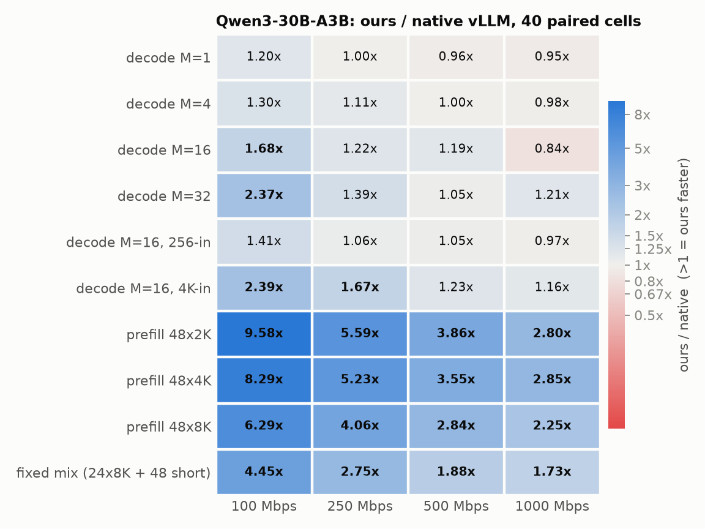

对原生 V2 的 40 项见 `figs/fig1b_a3b_vs_native_v2_heatmap.png`、
`data/a3b_vs_native_v2_cells.csv`。

**图 2：倍率随带宽变化。** 网络越是瓶颈，我们的优势越大。

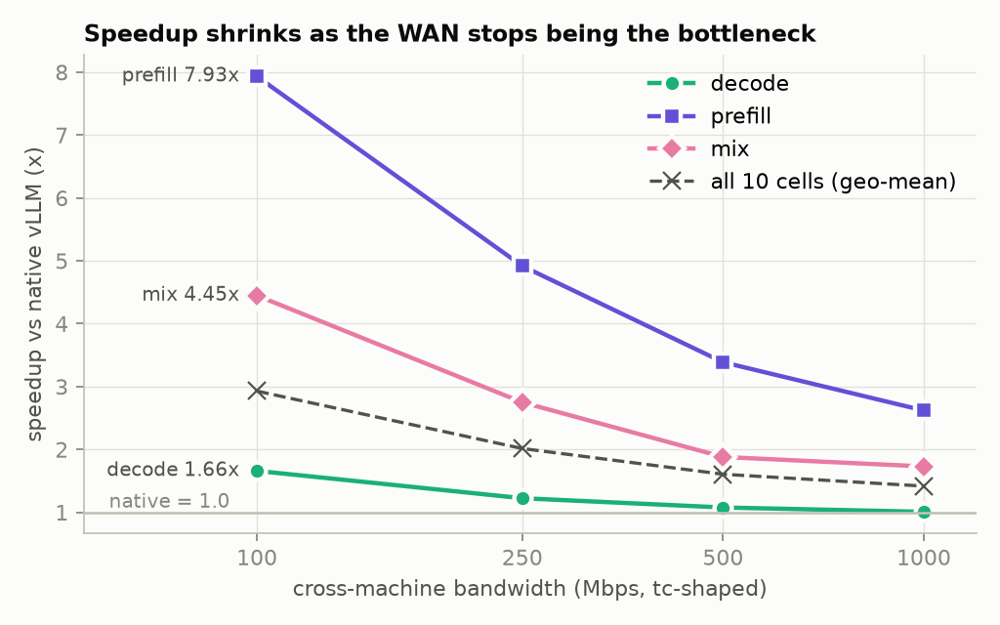

**图 3：decode 吞吐。** 100 Mbps 下 32 路 1,043 vs 441 token/s（2.37×）。单路（M=1）在
500 Mbps 以上略慢（0.95–0.96×）：单个用户时网络几乎不忙，省下的字节换不来时间，
反而要付传输层的额外开销。

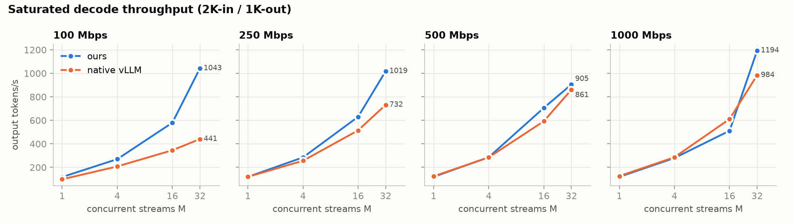

**图 4：prefill 和混合负载的总时长**（越低越好；柱上数字 = 原生时长 ÷ 我们的时长）

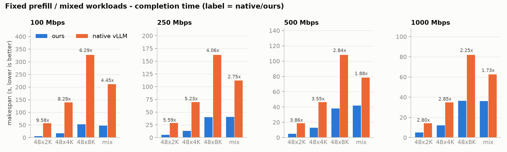

**图 5：过载 SLO 实验。** 原生把 155 个请求都做完了（原始产出 49.6 token/s），但首个
token 中位数要等 49 秒，没有一个满足 12 秒的要求；原生 V2 产出 62.4 token/s，首 token
中位数 9.0 秒，6 个达标。我们产出 65.5 token/s，首 token 中位数 1.0 秒，153 个达标；没达标
的 2 个是 ITL p95 超过 200 ms（303 / 319 ms），首 token 和平均 TPOT 都满足。

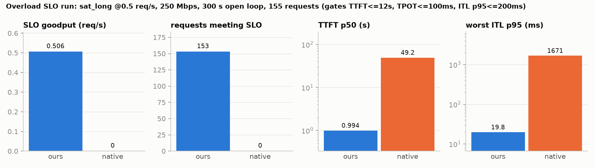

**图 6：跨机字节/token**

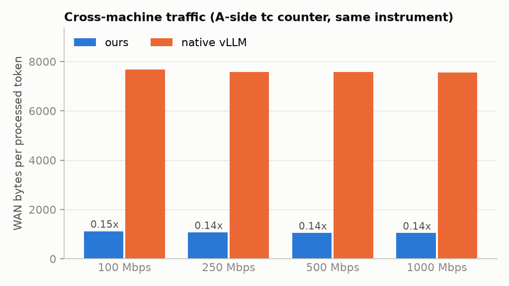

**每 token 的 GPU 时间**（decode 各项合计，4 张卡 × 总时长 ÷ 输出 token）：我们 4.8 ms，
原生默认 6.6 ms，原生 V2 6.9 ms。

**贪心输出**：我们的终版与开发过程中逐次验收的 int4 + 合并输出 3/3 逐词相同。

---

## 5. 消融：每项技术各贡献多少

### 5.1 怎么做的

每一行是一个独立的配置，各自重新启动引擎，跑同一组测试，顺序也相同：

- **吞吐**：decode M=4、decode M=32、prefill 48×8K、混合负载，各在 100 / 250 /
  1000 Mbps 下跑一次，共 12 项。对**原生默认（V1）**求几何均值（§2.4）。
- **服务质量**：250 Mbps 过载 SLO 实验（§2.2 最后一行），记录 155 个请求中满足全部
  时延要求的个数。

全部**关闭前缀缓存**（每个 token 都真算，避免 §2.5 的缓存复用干扰归因），2026-10-30 至
10-31 依次运行（机器负载 5–20），所有配置用同一份代码（含默认开启的逐步 trace）。数据：
`data/a3b_ablation.csv`，原始文件 `data/round6/`（`r6_*`），汇总脚本 `kit/ablate_tab.py`。

### 5.2 结果

| 配置 | 每 token 跨机字节 | 12 项吞吐几何均值 | 100 / 250 / 1000 Mbps | SLO 达标 | 首 token 中位数 | 最差 ITL p95 |
|---|---|---|---|---|---|---|
| 原生默认（V1 执行器） | 8192 | 1.00× | 1.00 / 1.00 / 1.00 | 0/155 | 53.9 s | 1682 ms |
| 原生，V2 执行器 | 8192 | 1.24× | 1.05 / 1.26 / 1.46 | 4/155 | 9.8 s | 2358 ms |
| 原生 V2，去掉 MoE 调参 | 8192 | 1.22× | 1.02 / 1.26 / 1.40 | 4/155 | 9.6 s | 2312 ms |
| 原生 V2 + tok-tail | 8192 | 1.32× | 1.18 / 1.34 / 1.45 | 11/155 | 8.1 s | 2312 ms |
| 上一行 + pp_link（bf16，两个向量） | 8192 | 1.24× | 1.15 / 1.25 / 1.33 | 9/155 | 8.1 s | 2329 ms |
| 上一行 + 合并（bf16） | 4096 | 1.64× | 1.73 / 1.82 / 1.41 | 118/155 | 1.7 s | 1083 ms |
| 上上行 + int4（不合并） | 2304 | 2.00× | 2.55 / 2.11 / 1.48 | 144/155 | 1.2 s | 807 ms |
| **pp_link + int4 + 合并 = `--best`** | **1152** | **2.28×** | **3.37 / 2.30 / 1.54** | 151/155 | **1.0 s** | 359 ms |
| `--best`，链路改回同步收发 | 1152 | 2.22× | 3.05 / 2.30 / 1.55 | 150/155 | 1.1 s | 622 ms |
| `--best`，不加 tok-tail | 1152 | 2.00× | 2.52 / 2.09 / 1.51 | 152/155 | 1.0 s | 355 ms |
| `--best` + TP-C（`--best-tpc`） | 1152 | 1.71× | 2.51 / 1.72 / 1.16 | **155/155** | 1.0 s | **114 ms** |

对原生 V2 的倍率 = 表中倍率 ÷ 1.24（例如 `--best` 1.83×，100 / 250 / 1000 Mbps 3.22 / 1.82 /
1.05×）。

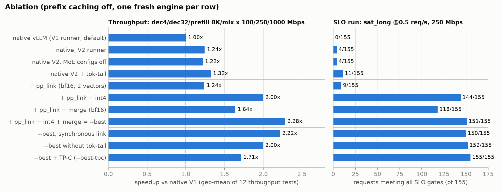

### 5.3 每项技术的贡献

- **V2 执行器**（上游代码，§3.1）：原生换 V2 本身就快 1.24×，带宽越高越明显（1000 Mbps
  1.46×），首 token 中位数从 54 s 降到 10 s。这部分不算我们的贡献，所以另报“对原生 V2”。
- **fused-MoE 调参**（§3.7）：去掉后原生 V2 慢 2%（1.24× → 1.22×）。双方共享，不贡献倍率。
- **tok-tail（控制面瘦身，§3.2）**：在原生 V2 上快 6%；在我们的系统上快 14%（2.00× → 2.28×），
  100 Mbps 下 2.52× → 3.37×。
- **pp_link 自身（§3.3）**：只换传输、仍发 bf16 两个向量时，比原生 NCCL 慢约 6%（1.32× →
  1.24×），输出逐词不变。传的字节一样多，它多了拷贝和线程开销。它的价值是承载后面的压缩，
  以及给 hi 通道插队。
- **残差合并（§3.5）**：单独加（字节减半）就到 1.64×，SLO 9 → 118。
- **int4 编码（§3.4）**：单独加（字节降到 28%）到 2.00×，SLO 9 → 144。贡献最大的单项。
- **两者叠加**：字节降到 14%，2.28×、SLO 151。在 int4 基础上再加合并还能快 14%，100 Mbps
  下从 2.55× 到 3.37×。字节越少越快，三档带宽都是同样的顺序。
- **异步收发（§3.3）**：比同步快 3%（2.22× → 2.28×），收益集中在 100 Mbps（3.05× → 3.37×），
  最差 ITL p95 从 622 ms 降到 359 ms。
- **TP-C（§3.6）**：吞吐降 25%（2.28× → 1.71×），换来 SLO 155/155、最差 ITL p95 114 ms。

**使用建议**：

| 目标 | 配置 | 依据 |
|---|---|---|
| 吞吐优先，或 B 端有两张以上的卡 | `--best` | 12 项 2.28×，SLO 151/155 |
| 严格的逐 token 时延（ITL p95），尤其 B 端单卡 | `--best-tpc` | SLO 155/155，最差 ITL p95 114 ms；吞吐低 25% |
| 精度敏感（要求与原生答案尽量一致） | `--link --codec int8 --merge --net-bw 0 --runner v2 --tok-tail` | §8 |

---

## 6. 其他模型和拓扑

### 6.1 Qwen3-32B（稠密模型，TP2×PP2）

**图 7：32B 的 40 项配对**

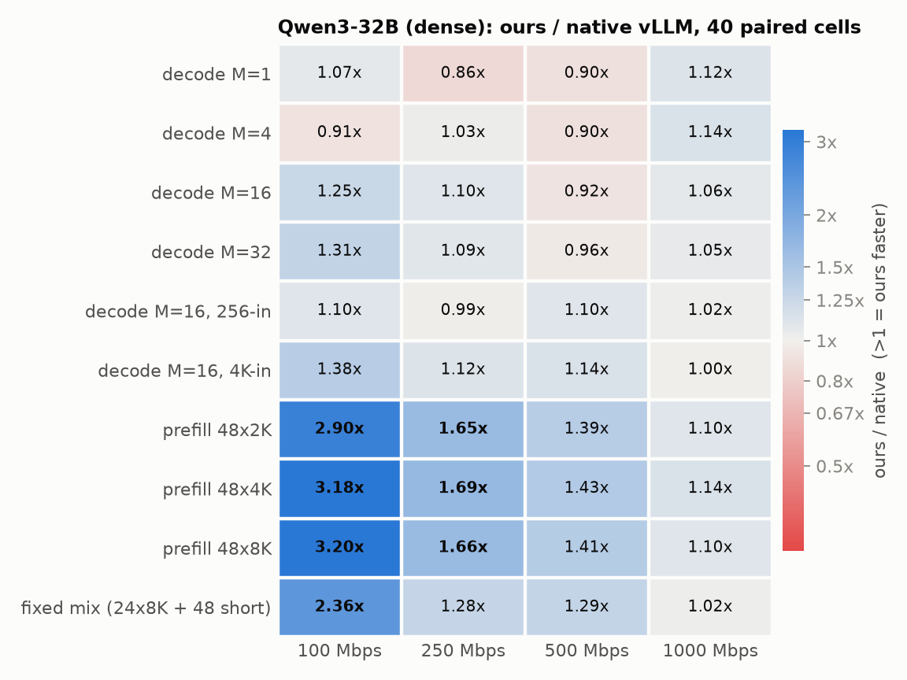

同一时段配对：我们 10-31 09:40–11:19，原生 11:20–13:40，负载 11–12。两边都 32/32 切分、
显存 0.90、KV 容量 89,280 token；我们是 `--best`（不开 TP-C）；32B 原生默认就是 V2 执行器。

- 40 项几何均值 **1.25×**，≤250 Mbps 的 20 项 **1.42×**；各档依次为 **1.67 / 1.21 /
  1.12 / 1.07×**，四档都领先。prefill 在 100 Mbps 下 2.9–3.2×、1 Gbps 下 1.10–1.14×；
  混合负载 2.36×（100 Mbps）到 1.02×（1 Gbps）；decode 四档几何均值 1.06×。弱项：
  250/500 Mbps 的单路、4 路 decode（0.86–0.90×）。
- **过载实验超出了这套硬件对 32B 的能力**：0.5 个/秒、每个 4–8K 输入，两边都做完了
  155 个请求，但**都是 0/155 达标**（首 token 要等几分钟）。只能比原始指标：我们输出
  31.0 token/s、原生 20.1（1.54×）；首 token 中位数 165 s 对 342 s。
- 32B 的倍率比 A3B 小，是因为 32B 每 token 的计算量大得多，跨机字节在总时间里占比小；
  B 机（3090）的算力是 decode 的上限。
- **为什么是 32/32 切分**：流水线并行时，vLLM 的 KV cache 容量取两段中**较小**的那个。
  A 多放层就会挤掉 A 的 KV 空间，让整个系统的 KV 容量下降、高并发时排队。32/32 让两段
  的 KV 空间相同。
- 这组数据跑通之前，同一配置有两次在 B 机显存耗尽，原因是 §3.3 的接收端显存泄漏；
  修好后这一次 40 项 + 过载实验全部完成，没有失败项。

### 6.2 PP4：4090, 4090 | 3090, 3090（四级流水线）

A 的两张 4090 各一级，B 的两张 3090 各一级（14/14/10/10 层），只有第 1→2 级跨机，
pp_link 只接管这一跳（`HETVLLM_PP_LINK_FROM=1`）。对比**原生 PP4**（同样四级），关前缀
缓存的 12 项 + 过载实验：

| | vs 原生 PP4（V1，默认） | vs 原生 PP4（强制 V2） | SLO 达标 |
|---|---|---|---|
| 我们（`--best --tp 1 --pp 4`） | **2.53×**（100: 3.50×，250: 2.69×，1000: 1.72×） | **1.90×**（3.25× / 1.97× / 1.06×） | 152 / 155（原生两种都是 0） |
| 我们 + TP-C | 2.01× | 1.51× | 155 / 155 |

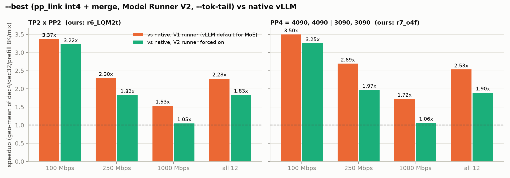

（图 11 左：TP2×PP2，右：PP4；都是关缓存的 12 项。）

和 TP2×PP2 比：我们的 PP4 是我们的 TP2×PP2 的 0.94×。prefill 在 250/1000 Mbps 快 34–48%、
100 Mbps 快 7%（没有机内 all-reduce）；decode 慢 3–37%（四级串行，每个 token 要过四段）。
所以 PP4 适合以 prefill 为主的负载。

### 6.3 Qwen3-8B：1 张 4090 + 1 张 3090

36 层，A 放 20 层、B 放 16 层，TP=1、PP=2。稠密 Qwen3 原生默认就是 V2；另测了一个强制
V1 的原生做参考。关前缀缓存的 12 项 + 过载实验：

| 配置 | vs 原生（V2，默认） | 100 / 250 / 1000 Mbps | SLO 达标 |
|---|---|---|---|
| 原生，强制 V1 | 0.87× | 0.93 / 0.82 / 0.85 | 0 / 155 |
| 原生（V2） | 1.00 | — | 0 / 155 |
| **我们，`--best`** | **1.97×** | 3.61 / 1.83 / 1.16 | 109 / 155 |
| **我们，`--best-tpc`** | 1.56× | 2.82 / 1.49 / 0.90 | **151 / 155** |

代表性的单项（`--best` / 原生）：48×8K prefill 88 s / 576 s（100 Mbps）、56 s / 99 s
（1000 Mbps）；混合负载 68 s / 364 s（100 Mbps）；decode M=32 704 / 200 token/s
（100 Mbps）、628 / 669 token/s（1000 Mbps，略慢）。

不开 TP-C 时 46 个请求不达标，全部是逐 token 时延（24 个只有 ITL p95 超标，22 个 TPOT 和
ITL 都超标）：B 只有一张 3090，4096 行的 prefill 块会让同批的 decode 等很久。TP-C 限制
每步行数，救回 42 个。贪心输出：`--best` 与原生 3 题里 2 题逐词相同、1 题第 4 个词后分叉
（int4 的有损效应，§8）；`--best` 与 `--best-tpc` 3 题全同。

只有一张卡的一侧要限制 Ray 的 GPU 数（`ray start --num-gpus 1`，kit 里的 `B_NUM_GPUS=1`），
否则 Ray 会把两级都放到空卡多的 B 上，根本不跨机。

上面的数字都是 20/16 切分。空泡率测量（§7.4）发现这个切分下 3090 已接近打满、4090 有一半时间
在等，改成 24/12 后空泡在 250 / 1000 Mbps 明显下降，混合负载做完时间快约 5%（100 Mbps 持平）。
12 项和过载实验没有用 24/12 重跑，所以默认切分仍是 20/16。

---

## 7. 空泡率

### 7.1 定义和测法

**空泡率 = 1 −（这张 GPU 上“有模型计算 kernel 在跑”的时间 ÷ 窗口时长）。**

- NCCL kernel 不算模型计算：all-reduce、broadcast、send/recv 在等对方时也在 GPU 上
  空转，看起来“忙”，其实在等。
- 多个 stream 同时有 kernel 时按时间并集算，不重复计。
- 剩下的时间再分两类：“只有 NCCL 在跑”（通信或在 NCCL 里等对方）和“没有任何 kernel”
  （GPU 在等输入、等 CPU、等网络）。

测法：每个系统一个新引擎，跑混合负载（72 个请求在开头一次性发出，整个测量窗口都满
负荷），用 torch profiler 只记录 GPU kernel（不记录 CPU 操作，因为记录 CPU 会拖慢主机，
自己制造出空泡），CUDA graph 保持开启。**所有 GPU 都只统计同一段稳定的 30 秒**（profiler
窗口开始后第 2–32 秒，`kit/bubble.py --clip 2:32`）：profiler 停止时要同步整理并
写出 trace，每秒约 1 万个 kernel 时这一步要卡住流水线约 2 分钟，还在记录的那一级在这段
时间里全在 NCCL 里等，会被错算成空泡。

### 7.2 结果

| 带宽 | GPU | 原生默认（V1） | 原生 V2 | **我们** | 相对原生默认降低 |
|---|---|---|---|---|---|
| 100 Mbps | A | 97.2% | 96.5% | **61.7%** | 36% |
| 100 Mbps | B | 95.9% | 95.0% | **61.2%** | 36% |
| 250 Mbps | A | 93.6% | 91.2% | **58.2%** | 38% |
| 250 Mbps | B | 90.4% | 88.0% | **56.3%** | 38% |
| 1000 Mbps | A | 82.2% | — | **56.0%**（重测 54.8%） | 32–33% |
| 1000 Mbps | B | 77.8% | — | **54.8%**（重测 51.5%） | 29–34% |

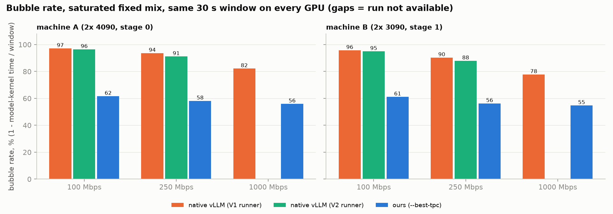

- **三档结论一致**：我们在每一档都明显低于原生。网络越慢，原生越差。模型计算占比是原生默认的
  13 / 9 倍（100 Mbps，A / B）、7 / 5 倍（250 Mbps）、2.5 / 2 倍（1000 Mbps）。
- 这里“我们”测的是开着 TP-C 的配置（保守：TP-C 会多拆步）。
- 原生 V2 在 1000 Mbps 开 profiler 的两次运行都卡死了（上游代码，没有我们的链路）：最后
  一个 prefill 完成、48 个请求转入纯 decode 时，B 的输出线程一直等不到采样 token 的拷贝
  完成，所有 worker 空等下一步。不开 profiler 时同样的负载没出过问题，触发条件没有继续
  定位。所以 1000 Mbps 只和原生默认比。500 Mbps 没有测。

**时间都花在哪**（250 Mbps，同一 30 秒窗口；“只有 X 在跑”= 这段时间里没有模型 kernel，
只有 X 类 NCCL kernel；不同 NCCL 种类之间可能重叠。`kit/nccl_split.py`）：

| | A 机（4090） | B 机（3090） |
|---|---|---|
| 原生默认 | 模型 6%；**只有 Broadcast 88%**（在等 B 送回采样 token）；SendRecv 42% | 模型 10%；**只有 SendRecv 80%**（在等网络送来数据）；all-reduce 10% |
| 原生 V2 | 模型 9%；只有 Broadcast 91%；SendRecv 82% | 模型 12%；只有 SendRecv 72%；all-reduce 15% |
| 我们 | 模型 42%；**只有 Broadcast 47%**；all-reduce 18% | 模型 44%；all-reduce 23%；**没有任何 kernel 30%** |

原生的 B 大部分时间在等网络，A 大部分时间在等 B。我们的 B 不再等网络，模型计算占比是
原生的约 5 倍；剩下的空泡有两个来源：B 有 30% 的时间没有任何 kernel（在等主机侧准备
下一步或等输入）；A 有约一半时间在等 B，因为 A 的 4090 算 28 层仍比 B 的 3090 算 20 层快。

### 7.3 TP2×PP2 离“空泡率相对降低 50%”还差多少

**TP2×PP2（Qwen3-30B-A3B）目前没有达到**：最好是 38%（250 Mbps）。单卡每级的 PP2
（1 张 4090 + 1 张 3090）在 250 Mbps 达到了，见 §7.4。250 Mbps 下要相对原生默认降低 50%，需要 A ≤ 46.8%、
B ≤ 45.2%，即两边的模型计算占比从约 42–44% 提高到约 53–55%。两个方向：

1. **B 的 30% “没有 kernel”**：B 在等主机侧。可做的是把 B 收到数据后的拷贝、反量化与上一步
   重叠；减少每步 Python 开销；让混合批也走完整的 CUDA graph。需要先给 B 的一步逐段计时。
2. **A 等 B（两段算力不平衡）**：只能把更多层挪到 A，但 A 的显存挡住了。fp8 KV cache 能让
   A 多放两层（30/18），实测 prefill 快 7–16%，但 decode 慢 4–12%（4090 上 fp8 KV 要换成
   FlashInfer 的 attention kernel），整体 0.97×，所以没采用。更好的办法可能是只把 A 上的
   权重换成 fp8（4090 支持 fp8 矩阵乘），不动 KV cache；没有试。§7.4 在显存够用的 Qwen3-8B
   上验证了这个方向：把层数从 20/16 改成 24/12 后，两段都降到 50% 以下。

增加同时在飞的批数没有用：V2 下 4 批与默认 3 批差别在 ±5% 以内。

### 7.4 PP2：1 张 4090 + 1 张 3090（Qwen3-8B）

两级流水线、每级一张卡（TP=1、PP=2），A 一张 4090、B 一张 3090。Qwen3-30B-A3B 两张 24 GB
卡放不下，所以用 Qwen3-8B（36 层）。三个系统：原生默认（稠密 Qwen3 默认就是 V2 执行器）、
强制 V1 的原生、我们（`--best`）。测法与 §7.1 相同（只记 GPU kernel、CUDA graph 开、所有
GPU 同一段稳定 30 秒），只有一处不同：负载是 §7.1 混合负载的 3 份（216 个请求，提示词互不
相同，开头一次性发出）。原来的 72 个请求，我们 50 秒左右就做完了，30 秒窗口的后半段会落在
收尾阶段，那时 GPU 没活干，算出来的空泡不代表流水线。

原生两组和“我们 20/16”用同一个切分（A 20 层、B 16 层，`kit/het.py` 里 Qwen3-8B 的默认切分，
它本身已经比 vLLM 的均分 18/18 更照顾 3090）。“我们 24/12”只改了切分（`--partition 24,12`）。

| 带宽 | GPU | 原生默认（V2） | 原生 V1 | 我们 20/16 | **我们 24/12** | 24/12 相对原生默认 / V1 降低 |
|---|---|---|---|---|---|---|
| 100 Mbps | A | 95.8% | 96.7% | 67.2% | **56.6%** | 41% / 42% |
| 100 Mbps | B | 92.6% | 93.3% | 44.4% | **56.0%** | 40% / 40% |
| 250 Mbps | A | 89.2% | 91.6% | 50.9% | **40.8%** | **54% / 56%** |
| 250 Mbps | B | 80.6% | 84.6% | 17.8% | **38.6%** | **52% / 54%** |
| 1000 Mbps | A | 66.6% | 79.9% | 42.0% | **30.1%** | **55% / 62%** |
| 1000 Mbps | B | 48.2% | 63.3% | 11.2% | **27.8%** | 42% / **56%** |

同一批 216 个请求全部做完的时间：

| 带宽 | 原生默认 | 原生 V1 | 我们 20/16 | 我们 24/12 |
|---|---|---|---|---|
| 100 Mbps | 1079 s | 1207 s | 225 s | 226 s |
| 250 Mbps | 478 s | 579 s | 188 s | 179 s |
| 1000 Mbps | 232 s | 283 s | 169 s | 161 s |

**能否满足 50%**：

- **250 Mbps：满足**。用 24/12，A、B 两段相对原生默认都降低一半以上（54% / 52%），相对原生
  V1 也一样（56% / 54%）。
- **1000 Mbps：对原生 V1 满足，对原生默认只有 A 满足**。原生默认在 1 Gbps 下已经不太差
  （B 48%），B 降到 27.8% 是 42%。
- **100 Mbps：不满足**。两种切分都只能让一段接近或达到 50%：20/16 时 B 降 52%、A 只降 30%；
  24/12 时两段都约 40%。

**为什么 20/16 时 A 一直不达标**：B 那张 3090 已经接近打满（250 Mbps 时模型计算占 82%，
1000 Mbps 时 89%），A 有一半时间在 Broadcast 里等 B 送回采样 token。按每层耗时算，3090 在这
个负载下比 4090 慢约 2.1 倍（A 20 层占 49%，B 16 层占 82%），平衡点约在 24/12。改成 24/12 后两段
的模型计算占比都在 60–72%（250 / 1000 Mbps），做完时间也快了 5%。

**为什么 100 Mbps 怎么切都不行**：这时瓶颈是网络。24/12 下 B 有 56% 的时间没有任何 kernel，
是在等 A 的数据过网络；A 在等 B 送回 token。把层挪来挪去不改变线路要传的字节数，两种切分做完
时间一样（225 / 226 s）。要在 100 Mbps 达标，只能继续减少每 token 字节数，或者按带宽选切分。

时间都花在哪（250 Mbps，`kit/nccl_split.py`）：

| | A 机（4090） | B 机（3090） |
|---|---|---|
| 原生默认 | 模型 11%；只有 SendRecv / Broadcast 89% | 模型 19%；**只有 SendRecv 80%**（在等网络） |
| 我们 20/16 | 模型 49%；**只有 Broadcast 51%**（在等 B） | 模型 82%；没有任何 kernel 18% |
| 我们 24/12 | 模型 59%；只有 Broadcast 41% | 模型 61%；没有任何 kernel 39% |

汇总在 `data/q8_pp2_bubble.csv`。

汇总在 `data/a3b_bubble_bands.csv`。kernel 级 trace 每次约 100 MB，共约 800 MB，没有放进
git（保存在测试机的 `exp/pp2/bubble/*/prof/`）；逐步 trace 在 `exp/pp2/bubble/*/trace/`。

---

## 8. 精度：量化对模型输出有多大影响

### 8.1 为什么要测，为什么有“merged bf16”

边界编解码只量化跨机传输的那一个向量，但它是有损的，所以要用公开数据集测它对精度
的影响。交付的配置都是“先合并、再量化”（merged int8、merged int4）。为了把**合并**
的影响和**量化**的影响分开，另外测了 **merged bf16（只合并、不量化）**：如果它和原生
一样，就说明合并本身无损，int8/int4 的差别只来自量化。原生跑了两次（“原生重跑”），
用来测同一个系统前后两次的差别（批处理顺序带来的浮点不确定性），作为判断“有没有差别”
的噪声基线。

五个配置都用同一份代码、同样的 V2 执行器和 tok-tail，只有边界编解码不同（2026-10-31
18:11–19:07，不限速）。

### 8.2 数据集和打分方式

全部贪心解码，同一提示词。

| 数据集 | 测什么 | 规模 | 打分方式 |
|---|---|---|---|
| WikiText-2（test） | 语言建模，对数值误差最敏感 | 299,077 token | 困惑度：2048-token 窗口、步长 1024，每个 token 至少有 1024 个 token 的上文 |
| MMLU（5-shot） | 57 个学科的知识题 | 14,042 题 | 比较下一个 token 是 " A"/" B"/" C"/" D" 的概率，取最大（lm-eval-harness 格式） |
| ARC-Challenge（5-shot） | 科学推理选择题 | 1,165 题（4 选项） | 同上 |
| GSM8K（5-shot） | 多步数学推理，中途错一个 token 就可能整题错 | 1,319 题 | 生成最多 384 token，取 `#### 答案` 严格匹配 |

### 8.3 结果

括号内是相对原生的变化（百分点）；“丢/得” = 原生对而该配置错的题数 / 原生错而该
配置对的题数；p 是配对 McNemar 精确检验，越小越说明差别是真的；“一致率” = 与原生
答案相同的比例。

| | 原生 | 原生重跑（噪声基线） | merged bf16 | **merged int8（质量档）** | **merged int4（吞吐档，`--best`）** |
|---|---|---|---|---|---|
| WikiText-2 困惑度 | 7.837 | 7.837 | 7.837 | 7.825 | 7.834 |
| MMLU | 79.50% | 79.46%（−0.04） | 79.63%（+0.13） | 79.47%（−0.04） | **78.83%（−0.67）** |
| MMLU 丢/得，p | — | 86/80，p=0.70 | 81/99，p=0.20 | 102/97，p=0.78 | **337/243，p=1.1×10⁻⁴** |
| MMLU 一致率 | — | 98.6% | 98.4% | 98.2% | **94.8%** |
| ARC-C | 93.91% | 93.99%（+0.09） | 93.91%（±0） | 93.99%（+0.09） | 93.30%（−0.60），p=0.12 |
| GSM8K 严格匹配 | 92.19% | 92.42%（+0.23） | 92.19%（±0） | 91.66%（−0.53），p=0.32 | 92.19%（±0），p=1.0 |
| GSM8K 一致率 | — | 95.7% | 96.7% | 96.1% | 92.9% |

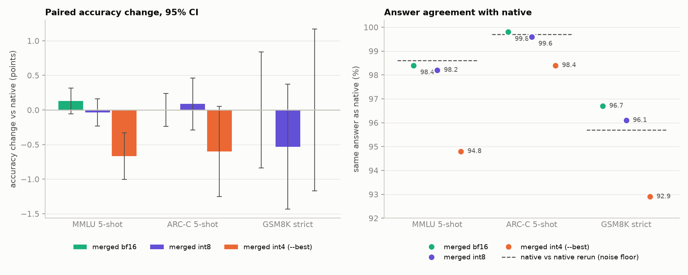

**结论**：

- **合并无损**：merged bf16 的各项都在原生自己重跑的波动范围内（困惑度相同，MMLU p=0.20）。
- **int8 与原生无法区分**：所有差别 p ≥ 0.32，一致率与噪声基线持平。
- **int4 有小而确定的损失**：
  - MMLU 下降 0.67 个百分点，统计上确定（丢 337 题、得 243 题）。
  - 与原生答案一致率 94.8%，低于噪声基线 98.6%。
  - ARC-C、GSM8K 正确率没有显著变化。
  - 困惑度不变，说明误差基本是无偏的噪声，主要翻转了本来就接近的选择。
- **int4 的另一个影响**：GSM8K 中 10.6% 的回答在写完 `#### 答案` 之后不停下，继续写
  （原生 3.3%）。答案本身没错，但平均输出变长约 20%（311 vs 260 字符），要多花生成时间。
- **选择建议**：吞吐优先用 int4（`--best`）；精度敏感（知识问答、要求与原生答案尽量一致）
  用 int8 + 合并。int8 每 token 跨机字节约是 int4 的 1.8 倍，弱网下吞吐会相应降低。

数据：`data/a3b_quant_accuracy.csv`（汇总）、`data/qeval/`（每个配置的结果和逐题预测）。
脚本：`kit/qeval.py`（评测）、`kit/qeval_cmp.py`（配对比较）、`kit/get_datasets.sh`（下载数据集）。

---

## 9. 试过但没有采用的技术

代码不在补丁里（记录在 git 历史中）。

| 技术 | 现状 |
|---|---|
| fp8 KV cache + 30/18 切分 | 实测整体 0.97×（prefill 快、decode 慢，§7.3），输出也不再与 bf16 KV 逐词一致 |
| 增加同时在飞的批数（4 批） | 实测与默认 3 批差别在 ±5% 以内 |
| inductor 通信融合（`fuse_allreduce_rms`、`fuse_gemm_comms`） | 在这两种卡上无法启用：all-reduce+RMSNorm 融合只有 sm90 / sm100 / sm103 的尺寸表，4090（sm89）/ 3090（sm86）查不到，pass 直接关闭；GEMM+通信融合需要 GPU 间 P2P，两台机器都没有 |
| 网络感知分块上限（TP-D，`--net-bw`） | `--best` 用 `--net-bw 0` 关掉；没有在本版重测 |
| 跨流水线投机解码、注意力数据并行 / 专家并行、本地分段 all-reduce、按专家分布自适应 `BLOCK_SIZE_M` | 早期版本试过，未带来收益，代码已删除；本版没有重测。投机解码见 §11 |

---

## 10. 局限（如实说明）

- **单一集群，每项只跑一次**，没有多次重复取置信区间。A3B 40 项和 32B 40 项各是一次同一
  时段配对；PP4、Qwen3-8B、消融的各配置是依次运行的（每个配置一个新引擎，负载 5–20），
  不是严格同时。相隔一天的两次原生默认运行（同样的 12 项，关缓存）相差约 2%。
- 机器有其他用户；时延类指标对此敏感，所以只比同时段配对。
- 关缓存 12 项的原生基线（V1、V2）和空泡率的原生默认基线都是 10-31 用和我们相同的代码重测的。
  更早一次测量的原生基线作废：那时默认开启的逐步 trace 每一步都让主机等 GPU 做完上一步，
  对原生也一样拖慢（原生 V2 被拖慢约 20%），用它算出的倍率偏高。
- 提示词是**随机 token ID**，衡量的是系统吞吐和时延，不代表真实文本分布；精度另见 §8。
- 40 项开着前缀缓存，V2 执行器在 48×2K / 4K 上复用得多，这部分进了“对原生默认”的倍率
  （§2.5）；关缓存的 12 项给出了不受缓存影响的口径。没有逐项测命中率。
- 1 Gbps 时单路、少路 decode 仍比原生略慢（0.95–0.98×），多路和 prefill 领先。
- `--best` 偏向吞吐（不开 TP-C）：A3B 过载实验里有 2 个请求的 ITL p95 超标；B 端单卡时
  （Qwen3-8B）不开 TP-C 有 46 个请求时延超标，应该用 `--best-tpc`。
- 32B 的过载实验超出了硬件能力，两边都是 0 达标，只能比原始产出和首 token 时间。
- 原生 V2 在 1000 Mbps 开 profiler 时卡死（§7.2），那一档的空泡率只和原生默认比；500 Mbps
  的空泡率没有测。
- PP2（1 张 4090 + 1 张 3090）的空泡率每个配置只测一次，所有运行都在 11-02 至 11-03 之间。原生两组
  用的是 20/16 切分，没有测原生在 24/12 下的空泡；原生的瓶颈是网络，换切分预计改变不大，但没有实测。
  原生默认 @1000 第一次运行时 B 端 worker 无报错退出，重跑成功；表里是重跑的数据。
- decode 倍率的上限受 B 机（3090）算力约束：网络不再是瓶颈后，再省字节也换不来速度。

---

## 11. 还能优化什么

按实测的剩余开销排序：

1. **B 的“无 kernel”时间（约 30%）**：见 §7.3 第 1 条。
2. **两段算力不平衡（A 约一半时间在等 B）**：只把 A 上的权重换成 fp8，多放几层到 A（本地
   没有 Qwen3-30B-A3B 的 fp8 权重，需要自己转换）。Qwen3-8B 上把切分改成 24/12 已经验证了
   这个方向（§7.4）。
3. **按带宽选切分**：PP2 下 100 Mbps 时 20/16 对 B 更好（线路是瓶颈），250 / 1000 Mbps 时
   24/12 更好。可以让切分随测得的带宽和每层耗时自动选（切分改变要重启引擎，适合部署时选一次）。
4. **高带宽下的小批 decode**（1 Gbps 下单路、4 路约 0.95–0.98×）：每步固定成本（编码、ZMQ、
   线程切换）占比高。可以对很小的消息跳过编解码。
5. **投机解码**：V2 执行器支持流水线并行下的 EAGLE。B 是 decode 的瓶颈，投机能摊薄每个
   token 读一遍 B 上权重的成本。需要为 Qwen3-30B-A3B 训练 EAGLE 头，并先验证草稿 token
   真的到达了验证端。
6. **上游 V2 + PP 的卡死**（§7.2）：定位触发条件后报给上游。

---

## 12. 目录

```
MoLink/（v2 分支根目录）
  README.md            项目总览（入口）
  docs/EVALUATION.md   本文
  docs/REPRODUCE.md    复现步骤（安装、配置、一键配对测试、预期结果和容差）
  make_figs.py         由原始数据生成 figs/ 和 data/*.csv
  figs/                fig0 架构、fig1/1b 40 项倍率、fig2–6 A3B 结果、fig7 32B、
                       fig9 精度、fig10 消融、fig11 12 项对原生（TP2×PP2 与 PP4）、
                       fig12 各带宽空泡率
  data/
    a3b_cells.csv               A3B 40 项（对原生默认）
    a3b_vs_native_v2_cells.csv  A3B 40 项（对原生 V2）
    d32_cells.csv               32B 40 项
    a3b_slo_satlong05_250.csv, a3b_wan_bytes.csv
    a3b_ablation.csv            消融（§5）
    a3b_bubble_bands.csv        各带宽空泡率（§7）
    a3b_tpc_dip_sweep.csv       TP-C dip 上限扫描（§3.6）
    q8_round6.csv               Qwen3-8B（§6.3）
    q8_pp2_bubble.csv           PP2（1 张 4090 + 1 张 3090）各带宽空泡率（§7.4）
    a3b_quant_accuracy.csv, qeval/   精度（§8）
    raw/               40 项配对的原始回放 JSON、逐请求记录 .reqs.json、贪心生成结果
                       （fin6_o/fin6_n/fin6_n2 = A3B 我们/原生默认/原生 V2；d9_o/d9_n = 32B）
    round6/            12 项测试的原始回放（消融、PP4 p4_*/r7_o4f、Qwen3-8B q8_*、dip 扫描 dip_*）
  patch/
    hetvllm-vllm-v0.23.0.patch   对上游 v0.23.0 的完整补丁
    DIFFSTAT.txt, README.md      逐文件说明和环境变量参考
  kit/
    cluster.env.example  集群描述（IP、网卡、GPU、venv；不含任何凭据）
    het.py               引擎生命周期：up/start/stop/wait/tc/pull-prof
    bench.sh             一键配对测试（原生默认 → 原生 V2 → 我们，4 档 × 10 项 + SLO + 贪心）
    replay.py            开环回放 + SLO goodput 统计
    greedy.py, greedy_cmp.py, accept_tab.py
    ablate.sh, ablate_tab.py     消融（§5）：逐配置跑 12 项 + SLO，汇总
    bubble.sh, bubble.py, nccl_split.py   空泡率（§7）：profiler 窗口、分析、NCCL 拆分
    qeval.py, qeval_cmp.py, get_datasets.sh   公开数据集精度评测
    moe_tune.py          fused-MoE 配置调参（§3.7；调好的配置已在补丁里）
```
